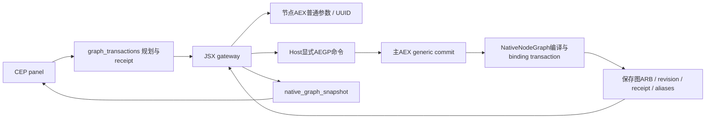

# Starfield 真实模块边界与数据流

这是当前工作树调用链审计，不把旧架构文档中的历史候选视为当前实现。等级沿用 [BASELINE.md](BASELINE.md)；以下职责/调用为**已证实的源码事实**，宿主资格另行验证。

## 职责与依赖

| 模块 | 实际职责 | 依赖 / 边界证据 |
| --- | --- | --- |
| CEP browser | 画布、inspector、预设、纯图编辑规划、pending/目标/receipt状态 | `panel.js:67,179,883` → evalScript；`graph_transactions.js:193` →快照/规划/普通或资源事务；不参与逐帧渲染 |
| ExtendScript gateway | 定位renderer/UUID、原生控件映射、结构修改、guard/undo、显式命令、fresh读回 | `starfield_gateway.jsx:1358,1996,2272`；`model_transaction_transport.jsx` 管理分页/事务脚本状态 |
| 节点 AEX | Emitter/Particle/Force/Transform/Model/Material/Motion/Turbulence原生作者控件；supervision同步、ARB资源/editor、SmartFX透传 | `NodeEffectMain.cpp`、`NodeEffects.cpp` → `NodeGraphSync.cpp:326` → `commit_native_graph_edit`；不是各自独立粒子渲染器 |
| 主 AEX | 参数与图carrier、ARB持久化、native编译/别名、历史/资源采样、SmartFX、GPU驱动、Core加载和world copy | `EffectMain.cpp:115,132,140` →SmartRender /原生提交；`Starfield.vcxproj:72,74` 也编译部分Core图实现 |
| resident Host AEX | AEGP命令、idle扫描、UI互斥、文件chooser、Model资源/整图事务与备份 | `StarfieldHost.cpp:120,202`；`ModelTransactionHost.cpp:198`；generic callback进入主AEX，再由主AEX查询Host exclusion |
| 图/求值Core | Graph校验/codec/registry、Output可达性、分支/资源、静态及temporal求值、Auxiliary | `Graph.cpp`、`GraphEvaluation.cpp:451,1274`、私有evaluation headers；宿主采样通过值/抽象sampler提供 |
| 粒子模拟Core | seed/身份/出生、绝对时间模拟、partition/selected输出、Force/样式 | `ParticleSimulation.cpp:415,444,526`；由图计划调用，不持有AE suite/stream |
| CPU/场景Core | sprite/model场景、ROI/PAR/相机、深度/覆盖、颜色/alpha/预算；GPU数值场景准备 | `CpuRenderer.cpp:161`、`SpriteScene.cpp`、`ModelScene.cpp`；GPU设备/dispatch在 `ae_plugin/GpuRender.cpp` |
| Core DLL | C ABI解码、调用渲染/inspect/GPU prepare、拥有并释放返回结果 | `PluginApi.cpp:203,254,298`；`PluginApi.h:113,142`，ABI9，接受明确的ABI7/8请求前缀 |

Output是主AEX的固定终端，没有独立Output AEX；Auxiliary复用Emitter作者结构。节点系统同时包含Core拓扑、native作者/alias和CEP投影，不能按文件夹把它当作单一独立模块。

## 编辑与发布链

普通事务实际顺序（`starfield_gateway.jsx:2272–2372`）：验证base revision/recordStamp →拒绝普通删除 →打开undo/renderer guard1 →创建/作者节点 →重新解析失效的indexed refs →写renderer → `triggerGraphCarrier`写nonce并 `app.executeCommand` →Host定位唯一未应答renderer → `AEGP_EffectCallGeneric` →native读取/编译/别名 →保存图及receipt →fresh snapshot并核对Motion mode →释放guard。

原生控件编辑是另一入口：NodeEffects监督通知 → `NodeGraphSync.cpp:326` 检查UI互斥/源guard/renderer →构造 `NativeEdit` → `NativeGraphCommit.cpp:187` 编译相同原生图并安装bindings。结构修改、ECW编辑和CEP编辑的通知时序不同，不能用Property.setValue mock自动发通知的假设统一它们。

删除/Model资源走整图事务：`graph_transactions.js:282` → `model_graph_transactions.js:49` 上传/queue/poll → JSX transport → `ModelTransactionHost.cpp:198` → `apply_model_graph_transaction` → `EffectGraphBackup` / prepare / commit / cleanup / final绑定验证。这个路径也处理非Model节点删除，“Model”名称不限定职责。

guard至少有renderer0正常/1编辑/2备份、source3退休；Host exclusion另有token。它们跨JSX/Host/Effect协作而不是一个局部bool。rollback先恢复graph/bindings，再物理删除新追加源；restore失败保持guard1（gateway:2343）。这是现有安全措施，未证明所有宿主身份错误已修复。

## 帧、资源和渲染链

```mermaid
flowchart LR
  A[AE Smart Pre Render] --> Q[checkout图 / active aliases /历史]
  Q --> X[相机 /纹理 /Model /灯光 /Motion值快照]
  X --> L[PreRenderState + Core generation lease]
  L --> F[AE Smart Render]
  F --> D[C ABI request]
  D --> E[图求值 /粒子 /CPU或GPU scene]
  E --> O[自有像素或场景result]
  O --> W[adapter copy或GPU dispatch到AE world]
  W --> Z[同generation release / checkin]
```

- `SmartRender.cpp:497`先checkout输入**几何元数据**，再 `checkout_render_graph`、native当前值/历史、Motion采样、Core lease。Model/Texture通过PF checkout和值拷贝进入预渲染状态；灯光/运动源采样代码留在adapter。
- `PreRenderState`（SmartRender:292）拥有graph bytes、motion exposure、纹理帧、model source/light vectors及generation；将内容身份参与GUID。`smart_render:687`配对input pixel checkout与output checkout，生成透明粒子RGBA，不读取输入像素做合成。
- C ABI `PluginApi.cpp:254`解码 owned Core request → `CpuParticleRenderer::render` → `evaluate_particle_graph` / flat `simulate_particles` → sprite/model栅格化。GPU走同一API表的prepare →owned scene →adapter设备dispatch。GPU声明/协商不等于硬件已资格通过。
- 图执行遵循Output祖先和edge顺序；资源依赖边也纳入可达性。静态路径 `GraphEvaluation.cpp:451`，temporal路径 `TemporalEvaluation.hpp:941`；Emit Once或Lifetime Random可使静态入口转入temporal（GraphEvaluation:1274），不只“参数动画”触发第二路径。
- Auxiliary递归在子出生时求父状态，工作budget跨递归共享；Motion/Force/Transform顺序和共享sprite basis/逐粒子affine影响CPU/GPU/Model全部路径。`MotionEvaluation.hpp:286`仍显式拒绝不同Motion链合流，这是当前功能限制，不能推断为依赖环。

## 所有权与全局状态

| 资源 / 状态 | 当前所有者与释放 | 判断 |
| --- | --- | --- |
| AE stream/effect refs、suite、ARB handle | adapter回调RAII；`NativeNodeGraph.cpp:1988` expression handle unlock/free；EffectGraphBackup只保存可恢复值 | 已见成对释放与failure fixtures，未发现足以确认泄漏的证据 |
| SmartFX预渲染状态 | AE持有opaque state，delete callback释放；SmartRender:300析构同generation GPU scene | owner明确；宿主异常调度覆盖待验证 |
| DLL像素/scene | PluginApi opaque handle由DLL分配；SmartRender:451 / MotionBlur:248以同API释放 | 不跨CRT delete；这是应保留的明确边界 |
| DLL generation | CoreLoader:16全局current+mutex；每个state持有shared lease，旧generation最后释放才FreeLibrary，loader锁外卸载 | 已证实机制；真实在途热切换gate开放 |
| temporal proofs/prefix缓存 | NativeTemporalCache:30–117的模块全局registry；32 proof sets、8 prefixes、131072 segments上限；UUID/stream/hz之外必须比较PF_State | 有界且有锁；跨复制图层/项目切换、host state语义待宿主验证，不能仅因全局就认定串实例 |
| Host事务session/queue | ModelTransactionHost:20–33单session，UI thread、5min deadline、running gate；execute重新定位目标，finish清空assets/borrowed layer（120–151、193） | 显式串行协议；不是Core全局模拟。不同target/取消/reload状态矩阵仍需覆盖 |
| 最近性能读数 | SmartRender:54进程内模块全局last timing；EmitterHistory.hpp:17明确非instance-specific | 多实例诊断可能错归因，已证实读数范围；不是像素污染证据 |

## 环与跨层边界审计

取证 `dependencies.json`：186个project-owned C/C++文件，473条可解析quoted include边，未发现多节点强连通分量，未发现Core→adapter include；另外SDK类型关键词搜索未发现Core反向AE类型引用。该扫描未展开预处理、动态函数指针或全部JS载入关系，**不宣称全程序无环**。

Host→Effect generic→Host exclusion export是实际运行时双向协作（StarfieldHost:190、UiExclusionClient.hpp:13），不构成链接target环；回调重入/线程允许范围**待验证**。Core sampler回调adapter属于显式抽象依赖倒置，不是已证实越层。

高耦合位置是NativeNodeGraph的参数codec/host读值/编译/alias事务/帧采样/metadata集中，以及普通与整图事务跨模块状态协调。证据和治理顺序见 [TECH_DEBT.md](TECH_DEBT.md)，不据行数推导拆分方案。
